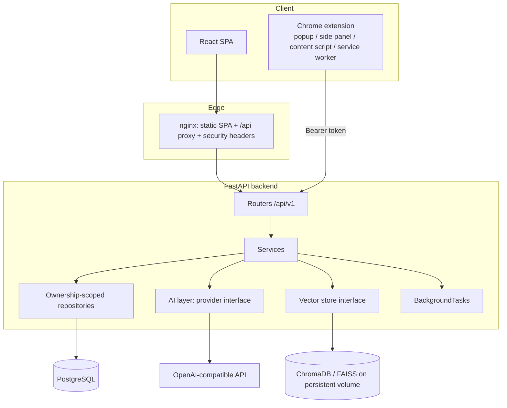
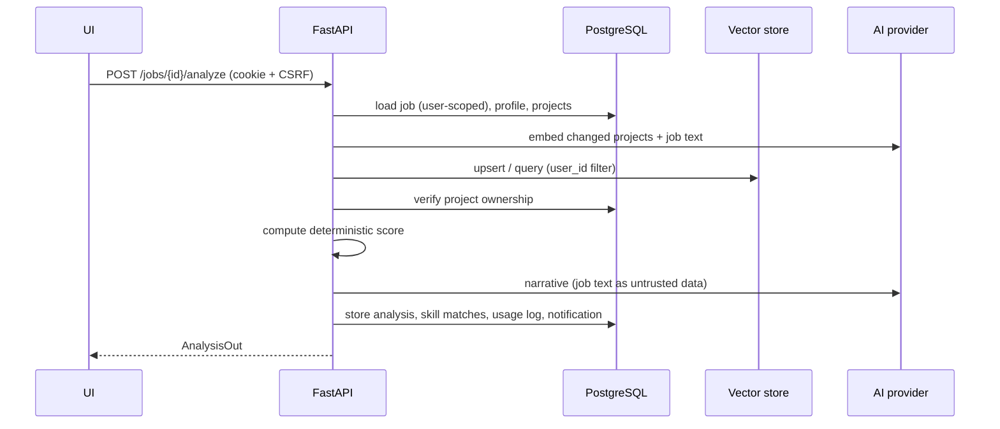

# Architecture

## Components



## Key decisions

| Decision | Rationale |
| --- | --- |
| **Deterministic Fit Score + AI narrative** | Scores are reproducible, explainable, testable and cannot be manipulated by prompt injection. The LLM only writes the explanation, feasibility notes and additional evidence-backed warnings. |
| **PostgreSQL is authoritative** | Vector hits are candidates. Every hit is re-checked against the user's rows before use. |
| **Provider and vector-store interfaces** | `app/ai/base.py` and `app/vector_store/base.py` keep vendor code out of business logic. A mock provider powers tests and demo mode. |
| **Cookie sessions for the web, bearer tokens for the extension** | HttpOnly cookies + CSRF protect the SPA; the extension cannot use page cookies and stores a rotating refresh token in `chrome.storage.local`. |
| **Same-origin deployment** | nginx (prod) / Vite proxy (dev) serve SPA and API from one origin, so cookies work without third-party cookie issues. |
| **In-process background work** | `auto_analyze_jobs` runs via FastAPI BackgroundTasks with its own DB session. It is written so it can move to a Redis/RQ/Celery worker without service changes. |
| **No scraping or automation** | Jobs come from the user (manual, paste, CSV, user-clicked extension extraction). Nothing is submitted automatically. |

## Request lifecycle (analyze job)



## Backend layout

```
app/api/v1      routers (validation, auth, status codes)
app/core        settings, logging (redaction), error format
app/db          engine/session, declarative base
app/models      SQLAlchemy models
app/schemas     Pydantic request/response models
app/repositories ownership-scoped lookups, pagination
app/services    business logic (auth, scoring, analysis, proposals, jobs, resumes, notifications, usage)
app/ai          provider interface, OpenAI + mock providers, prompts, output schemas
app/vector_store interface + Chroma/FAISS/in-memory stores
app/security    passwords, tokens, rate limits
app/tasks       background jobs
app/cli.py      create-admin, seed-demo
```
