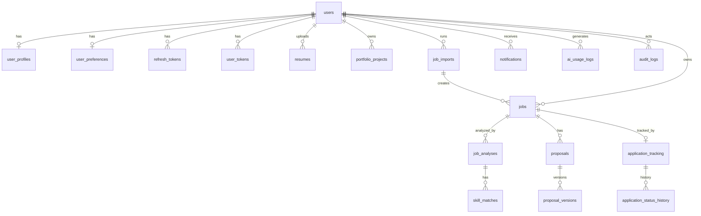

# Database

PostgreSQL with SQLAlchemy 2 models (`backend/app/models`) and Alembic migrations (`backend/alembic/versions`). All primary keys are UUIDs; timestamps are `timestamptz`; money uses `NUMERIC` (never floats); flexible lists use `JSONB`.



| Table | Purpose / notable constraints |
| --- | --- |
| `users` | Unique lowercase email, Argon2id hash, role, active flag |
| `refresh_tokens` | SHA-256 hashed token (unique), family id for reuse detection, revocation |
| `user_tokens` | Hashed single-use reset/verification tokens with expiry |
| `user_profiles` | One per user; `hourly_rate NUMERIC(10,2)`, `min_budget NUMERIC(12,2)`, `profile_version` (bumped on scoring-relevant change) |
| `user_preferences` | Fit Score alert threshold, notification and auto-analysis flags |
| `resumes` | Metadata, extracted text/data, status; `storage_path` only if retention enabled |
| `portfolio_projects` | Content + embedding status/hash/model (dedupes embeddings) |
| `job_imports` | Each import batch: counts and per-line errors |
| `jobs` | Unique `(user_id, fingerprint)` and partial unique `(user_id, normalized_url) WHERE normalized_url IS NOT NULL`; denormalised latest score for filtering |
| `job_analyses` | Full result JSON, weights, scoring version, provider/model, profile version, simulated flag |
| `skill_matches` | matched/partial/missing skills per analysis (analytics) |
| `proposals` / `proposal_versions` | Current text + immutable versions; unique `(proposal_id, version_number)`; tokens & `NUMERIC(12,6)` cost |
| `application_tracking` | Unique `(user_id, job_id)`; user-entered status/dates/value |
| `application_status_history` | Every status change |
| `notifications` | Unique `(user_id, dedupe_key)` |
| `ai_usage_logs` | Per call: operation, model, tokens, estimated cost, success/error code |
| `audit_logs` | Security-relevant and admin actions (no secrets or user content) |
| `system_settings` | Admin-configurable JSON (scoring weights/thresholds, AI model overrides, usage limits) |

All user-owned tables cascade on user deletion. Multi-row operations (CSV import, analyses + skill matches, proposal + version, status + history) run in one transaction; CSV rows use savepoints.

## Commands

```bash
alembic upgrade head
alembic revision --autogenerate -m "message"
alembic check
```

No default users are created. Use `python -m app.cli create-admin --email ...` (prompts for a password).
